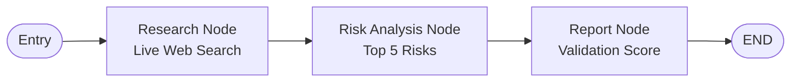
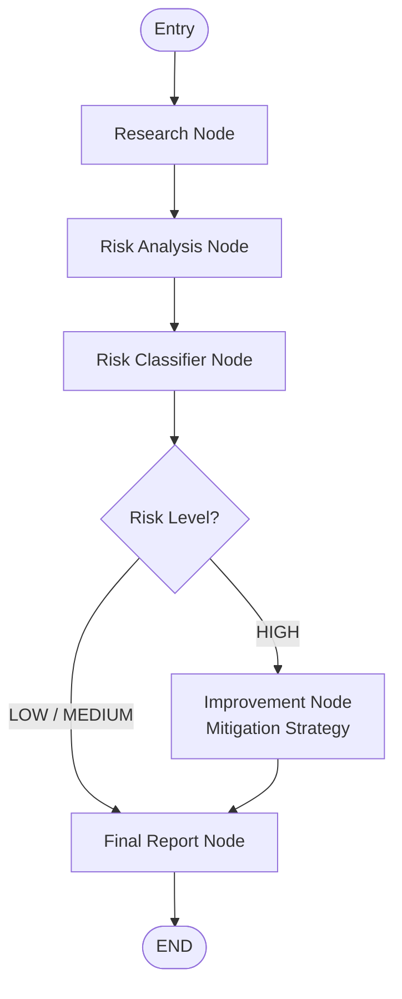
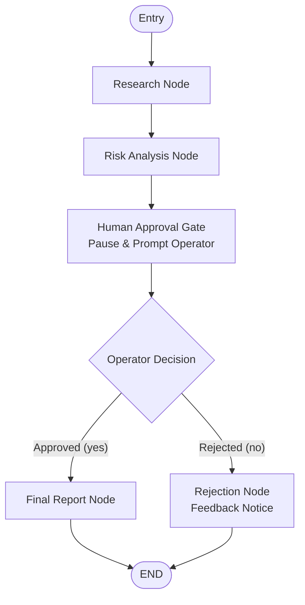

# Classroom LangGraph Workflows

A comprehensive, progressive reference implementation demonstrating how to build autonomous AI agents and structured agentic workflows using **Groq** (LLaMA 3.1), **DuckDuckGo Search**, and **LangGraph**.

---

## 🚀 Overview

This repository demonstrates the step-by-step evolution of agentic AI systems:
1. **Raw LLM Calls**: Direct inference using Groq's high-speed API.
2. **Rule-Based Tool Calling**: Intent parsing and routing to specialized tools (e.g., calculator).
3. **Live Web Search Agent**: Grounding LLM responses with real-time web retrieval.
4. **LangGraph Linear Pipeline**: Orchestrating multi-node sequential state machines.
5. **LangGraph Conditional Routing**: Dynamic branching based on runtime evaluation and risk scoring.
6. **LangGraph Human-in-the-Loop (HITL)**: Integrating human oversight gates into autonomous execution.

---

## 📁 Repository Structure

```text
langraph workflows/
│
├── Code-Explain.ipynb                     # Original interactive Jupyter Notebook
├── 01_basic_llm.py                        # Module 1: Direct Groq LLM integration
├── 02_simple_calculator_agent.py          # Module 2: Simple tool-using agent
├── 03_web_search_agent.py                 # Module 3: Real-time web research agent
├── 04_langgraph_linear_workflow.py        # Module 4: Linear sequential LangGraph
├── 05_langgraph_conditional_workflow.py   # Module 5: Conditional routing LangGraph
├── 06_langgraph_human_in_the_loop.py      # Module 6: Human-in-the-loop review workflow
├── main.py                                # Interactive CLI runner for all modules
│
├── requirements.txt                       # Project dependencies
├── .env.example                           # Sample environment configuration
└── README.md                              # Complete documentation
```

---

## 🛠️ Prerequisites & Setup

### 1. Python Environment
Python 3.10 or higher is recommended.

```bash
# Optional: Create and activate a virtual environment
python -m venv venv

# Windows (Command Prompt or PowerShell)
venv\Scripts\activate
```

### 2. Install Dependencies
```bash
pip install -r requirements.txt
```

### 3. Configure API Key
Create a `.env` file in the root directory:
```bash
cp .env.example .env
```
Open `.env` and insert your [Groq API Key](https://console.groq.com/keys):
```env
GROQ_API_KEY=gsk_your_groq_api_key_here
```

---

## 🧩 Architectural Patterns & Workflows

### 1. Linear Sequential Pipeline (`04_langgraph_linear_workflow.py`)
A structured pipeline where output states cascade sequentially through specialized nodes.



- **State Schema**:
  - `idea`: Raw startup concept.
  - `research`: Competitor & market findings.
  - `risks`: Evaluated risk factors.
  - `final_report`: Comprehensive validation report.

---

### 2. Conditional Routing Workflow (`05_langgraph_conditional_workflow.py`)
Evaluates state dynamically and branches to remediation nodes when elevated risk is detected.



- **Router Logic**:
  - If `risk_level` contains `"HIGH"`, routes to `improvement` before final synthesis.
  - Otherwise, proceeds straight to `final_report`.

---

### 3. Human-in-the-Loop Governance (`06_langgraph_human_in_the_loop.py`)
Introduces human authorization checkpoints into the graph before irreversible actions or final reports.



---

## 💻 Running the Code

### Option 1: Interactive Unified CLI Runner
Run the interactive console menu to execute any module or run validation on your own startup ideas:
```bash
python main.py
```

### Option 2: Execute Specific Modules Directly

```bash
# 1. Basic LLM invocation
python 01_basic_llm.py

# 2. Simple calculator & tool agent
python 02_simple_calculator_agent.py

# 3. Web research agent
python 03_web_search_agent.py

# 4. Sequential LangGraph workflow
python 04_langgraph_linear_workflow.py

# 5. Conditional routing LangGraph workflow
python 05_langgraph_conditional_workflow.py

# 6. Human-in-the-loop approval workflow
python 06_langgraph_human_in_the_loop.py
```

### Option 3: Interactive Jupyter Notebook
Launch Jupyter to explore the notebook cell-by-cell:
```bash
jupyter notebook Code-Explain.ipynb
```

---

## 🔍 Key Concepts Summary

| Concept | Implementation | What It Demonstrates |
| :--- | :--- | :--- |
| **Direct Inference** | `01_basic_llm.py` | Fast LLM interaction via Groq client using `llama-3.1-8b-instant`. |
| **Tool Calling / Router** | `02_simple_calculator_agent.py` | Distinguishing between computational tasks and natural language tasks. |
| **Grounding / RAG** | `03_web_search_agent.py` | Combining live search results (`duckduckgo-search`) into system prompts. |
| **State Graphs** | `04_langgraph_linear_workflow.py` | Managing immutable states with `TypedDict` across sequential nodes. |
| **Conditional Edges** | `05_langgraph_conditional_workflow.py` | Branching decisions using `add_conditional_edges` and decision functions. |
| **Human-in-the-Loop** | `06_langgraph_human_in_the_loop.py` | Human oversight gates controlling workflow state transitions. |
